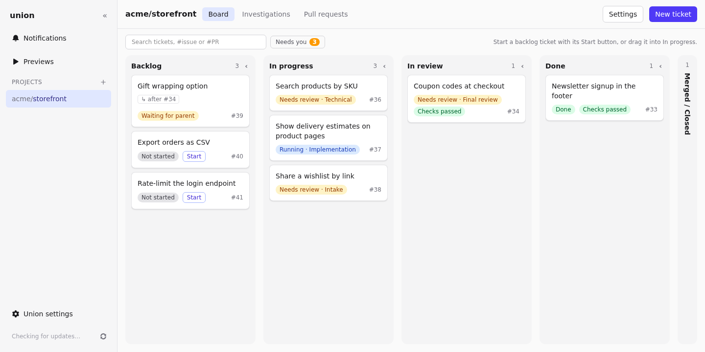
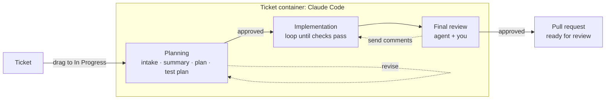
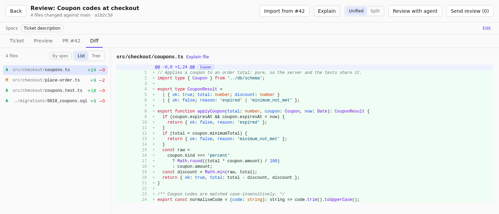

<div align="center">

# Union

**A local Kanban board where Claude agents do the work.**

Write a ticket, drag it to _In Progress_, and review a pull request.


[Features](#features) · [How it works](#how-it-works) · [Quick start](#quick-start) ·
[Configuration](#configuration) · [Documentation](#documentation) · [Development](#development)

</div>

---

Union sits on top of a **GitHub Project**. Each ticket you move to **In Progress** gets its own Docker container in
which **Claude Code**, running on your Claude Max subscription, plans the change with you, implements it until the
project's checks pass, and has it reviewed by a second agent. You stay in control at every step: nothing moves forward
until you approve it.

Everything runs on your machine. Credentials stay in a local SQLite database and never reach the agent containers.



## Features

- 🗂️ **Kanban over GitHub Projects**: one board per project, mirrored both ways: one issue per ticket, one comment
  per step, the ticket's column on the Project board, and "blocked by" links between issues.
- 🧭 **Planning with you in the loop**: intake (clarifying questions you answer inline), summary, technical plan and
  test plan. **Approve** each step or **Revise** it with feedback.
- 🛠️ **Implementation that passes your checks**: the agent writes the code and loops on your check command (for
  example `bun run check`) until it passes. Union pushes the branch and opens a draft pull request.
- 🔍 **Agent and human review**: a separate agent reviews the branch against the plan. Review the diff in Union,
  comment on lines, and send the comments back to the implementer.
- 🔗 **Ticket dependencies and PR stacks**: a ticket can wait for another one and start from its branch; a large pull
  request can be split into stacked ones.
- 🌿 **Branch tools**: rebase onto the latest base, move a finished ticket onto another base, or simplify its history
  for review.
- 🖥️ **Preview environments**: run a ticket's branch with the repository's own Docker Compose file, at
  `http://t<id>.union.localhost:8080`.
- 🔬 **Investigations**: one-off agent runs on a prompt of your own, with the model and tools you pick, and follow-up
  questions. No ticket, no GitHub issue.
- 🧠 **Memory**: lessons per agent step, curated from your feedback and reused on the next tickets.
- ⚙️ **Configurable agents**: edit each step's prompt, model, thinking effort and tools, write your own agents, and
  choose which steps a ticket's flow runs.
- 📥 **Notion import**: pull tickets from a Notion database.
- ⚡ **Parallel by default**: each ticket keeps its own container and volumes, so work survives between steps and
  several tickets run at once, up to a concurrency limit.

## How it works



| Phase              | What happens                                                                                    | Your part                                    |
| ------------------ | ----------------------------------------------------------------------------------------------- | -------------------------------------------- |
| **Planning**       | Intake, summary, technical plan and test plan; each is a tab on the ticket                      | Answer questions, approve or revise each tab |
| **Implementation** | The agent writes code and runs the project's checks until they pass; the host pushes a draft PR | Wait, or watch the live log                  |
| **Final review**   | A reviewer agent checks the branch against the plan                                             | Review the diff, comment, approve            |
| **Done**           | The pull request is marked ready for review                                                     | Merge on GitHub                              |

<table>
  <tr>
    <td width="50%"></td>
    <td width="50%"></td>
  </tr>
  <tr>
    <td align="center"><b>Approve each planning step</b>, or ask for a revision</td>
    <td align="center"><b>Review the diff</b> and send line comments to the implementer</td>
  </tr>
  <tr>
    <td width="50%"></td>
    <td width="50%" valign="middle">
      <b>Investigations</b>: ask an agent about the repository or any subject, then follow up or turn the answer
      into a ticket.
    </td>
  </tr>
</table>

<sub>Screenshots show a demo project.</sub>

Under the hood, Union is two Bun processes sharing one SQLite database:

- **web**: a Hono API and a React SPA. It reads state, writes plain records, and streams events to the browser over
  SSE. It never runs agents or writes to GitHub.
- **worker**: drains a queue of commands, drives each ticket's state machine, starts agent containers through the
  Docker socket, and does every clone, push and GitHub call.

## Quick start

### Requirements

- **Linux or WSL2** with **Docker** (Compose v2).
- **Claude Code** logged in on the host with your Claude Max account. Union seeds each container with the credential
  from `~/.claude/.credentials.json`; run `claude` once and log in if that file does not exist.
- A **GitHub repository** with a GitHub Project (the setup wizard can create one), and one of:
  - a **fine-grained token** for an organization repository: resource owner = the organization; repository
    permissions Contents, Issues and Pull requests read and write; organization permission Projects read and write;
  - a **classic token** with the `repo` and `project` scopes (required when the Project belongs to a user account);
  - a **GitHub App** installed on the organization ([see below](#using-a-github-app)).
- Optional: a **Notion** internal integration to import tickets.

### Run it

```sh
git clone git@github.com:LeoDurillon/Unions.git
cd Unions
bun run compose        # or: docker compose up --build
```

The first start installs the dependencies, builds the agent image (`union-agent:local`), then starts the web app and
the worker. Open **<http://localhost:5173>**.

> [!TIP]
> If the worker cannot reach Docker, set the group of the Docker socket (and your user id if it is not 1000) in a
> `.env` file next to `compose.yaml`:
>
> ```sh
> echo "DOCKER_GID=$(stat -c %g /var/run/docker.sock)" >> .env
> echo "UNION_UID=$(id -u)" >> .env
> echo "UNION_GID=$(id -g)" >> .env
> ```

Stop the stack with `bun run compose:down`; follow the logs with `bun run compose:logs`.

<details>
<summary><b>Without Docker Compose</b></summary>

Needs **Bun 1.4.1** and git on the host.

```sh
bun install
docker build -t union-agent:local -f docker/agent.Dockerfile docker
bun run dev            # web on http://localhost:5173 and the worker, with reload
```

`bun run start` builds the client and runs the production server on <http://localhost:3000> with the worker.

</details>

### Your first project

The setup wizard opens on first run (later: **+ Add project** in the sidebar):

1. **Connect**: paste a token and click **Verify**, or switch to **GitHub App**.
2. **Repository**: pick the repository the agents work on.
3. **Project**: pick an existing GitHub Project or create one.
4. **Notion** (optional): integration secret and data source ID.
5. **Review**: check the base branch and create the project.

Then open the project's **Settings** and set the install and check commands (for example `bun install` and
`bun run check`): the implementation step loops on the check command until it passes.

### Using a GitHub App

Open **GitHub App** in the sidebar, enter the organization and click **Create the GitHub App**: GitHub opens with the
permissions filled in. Paste the App ID and the generated private key (`.pem`) into Union, install the app on the
organization, then pick that installation in the wizard or in the project's **Settings → General**. Issues, comments
and pull requests are then authored by the app.

> [!NOTE]
> Apps and fine-grained tokens cannot reach Projects owned by a user account; use a classic token for those.

## Configuration

Environment variables (in a `.env` file at the repository root), all optional; the
[settings reference](documentation/settings.md#environment-variables) lists them all:

| Variable                   | Default                               | Purpose                                                  |
| -------------------------- | ------------------------------------- | -------------------------------------------------------- |
| `GITHUB_TOKEN`             | none                                  | Token for projects that have no credentials of their own |
| `UNION_MAX_CONCURRENT`     | `2`                                   | Agent runs at the same time, tickets and investigations  |
| `UNION_GITHUB_PULL_MS`     | `30000`                               | How often changes made on GitHub are pulled              |
| `UNION_WEB_PORT`           | `5173`                                | Port of the web app (Compose)                            |
| `UNION_PREVIEW_PORT`       | `8080`                                | Port of the preview environments' proxy (Compose)        |
| `DB_PATH`                  | `union.sqlite` at the repository root | Database file shared by web and worker                   |
| `UNION_CLAUDE_CREDENTIALS` | `~/.claude/.credentials.json`         | Claude credential seeded into containers                 |
| `UNION_AGENT_IMAGE`        | `union-agent:local`                   | Image agent containers run from                          |

Agent prompts, models, thinking effort and allowed tools are edited in **Union settings** in the sidebar and stored
in the database.

### Database

All state lives in `union.sqlite` at the repository root.

| Command                     | Effect                                                                                       |
| --------------------------- | -------------------------------------------------------------------------------------------- |
| `bun run db:backup [file]`  | Consistent copy into `backups/`, safe while the app runs                                     |
| `bun run db:restore <file>` | Restores a backup (stop the app first; the current database is saved)                        |
| `bun run db:reset --yes`    | Empty database; removes the agent containers of deleted tickets. GitHub and Notion untouched |

### Updating

When your checkout is behind `origin/main`, **Update** in the sidebar fast-forwards it and restarts Union under
Compose.

## Security model

- Union runs on your machine only. There is no authentication on the web UI: do not expose it.
- GitHub tokens, the GitHub App key and the Notion secret stay in the local database. They never reach the browser
  or the agent containers: the host does every clone, push and GitHub call.
- A ticket's container gets only the `claudeAiOauth` credential, not your Claude history or MCP logins. Known risks
  are listed in the [spec](docs/spec/README.md#open-risks).

## Documentation

**Using Union:** the [user guide](documentation/README.md) covers installation, the ticket lifecycle, reviews,
previews, agents, settings and troubleshooting.

| Start here                                                       |                                                           |
| ---------------------------------------------------------------- | --------------------------------------------------------- |
| [Installation](documentation/installation.md)                    | What you need and how to start Union                      |
| [Your first project](documentation/first-project.md)             | GitHub access, repository, checks                         |
| [From ticket to pull request](documentation/ticket-lifecycle.md) | Planning, implementation, final review                    |
| [Reviewing changes](documentation/reviewing.md)                  | The diff, comments, Explain, other people's pull requests |
| [Settings reference](documentation/settings.md)                  | Every settings page and environment variable              |
| [Troubleshooting](documentation/troubleshooting.md)              | Common problems and fixes                                 |

**Working on Union's code:** [`AGENTS.md`](AGENTS.md) for the layout and rules, [`docs/spec/`](docs/spec/README.md)
for the design and its decisions, [`docs/architecture/`](docs/architecture/) for how each part is built, and
[`docs/plans/`](docs/plans/README.md) for what is not built yet.

## Development

```text
apps/
  web/        Hono API + React SPA (Vite, Tailwind)
  worker/     command queue, state machines, agents, GitHub sync
packages/
  core/       schema and migrations, pure state machine, default agent prompts, ContainerRuntime
docker/       agent image and dev image
docs/         spec, architecture, plans, file maps
```

```sh
bun install            # dependencies and git hooks
bun run dev            # web + worker with reload
bun test               # tests
bun run check          # format, maps, lint, ast-grep, knip, duplication, secrets, typecheck, tests
```

`bun run check` must pass before committing. Read [AGENTS.md](AGENTS.md) for the layout, the rules and the lint
limits.

**Built with** [Bun](https://bun.sh), [TypeScript](https://www.typescriptlang.org),
[Hono](https://hono.dev), [React](https://react.dev), [Vite](https://vite.dev),
[Tailwind CSS](https://tailwindcss.com), [Drizzle ORM](https://orm.drizzle.team) on SQLite, and
[Claude Code](https://claude.com/claude-code).
