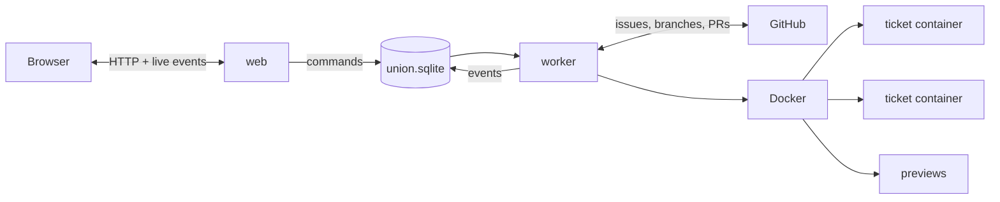

# How Union works

You do not need this page to use Union. It explains what runs where, so you can judge what Union does with your
code, your credentials and your Claude usage.

## Processes

- **web** serves the page and an API. It reads the database and streams changes to your browser as they happen. It
  never runs an agent, never starts a container and never writes to GitHub: when you click Start, Approve or
  Retry, it writes a command to the database.
- **worker** handles those commands. It runs each ticket's steps, starts the containers, runs the agents, and does
  every GitHub write: issues, comments, Project status, pushes and pull requests. It reads GitHub every 30 seconds
  for changes made there.
- **union.sqlite** holds everything both share. Restarting the web or the worker never touches running containers.

## Containers

Each ticket gets a container and two volumes: its **workspace** (the repository) and its **home** (the agent's
session, so a revision continues the same conversation). The container stops between steps and starts again for the
next one, and the volumes stay until the ticket is removed. That is why several tickets can run at once without
seeing each other's changes.

Investigations, Explain, agent reviews of pull requests and the lesson writer run in throwaway containers, removed
when they finish.

Inside a container, the agent is the Claude Code CLI (`claude -p`), run with the prompt, model, effort and tools of
its step.

## Credentials

- **Your Claude login**: each container gets the Claude credential from `~/.claude/.credentials.json`, and nothing
  else from your Claude configuration: no history, no MCP logins.
- **GitHub**: tokens and the GitHub App's key stay in the database. They never reach the browser nor the agents'
  containers. The worker clones, fetches and pushes for the agents, from the host. The agents cannot push.
- **Notion**: the integration secret stays in the database, and only the worker writes to Notion.
- **Preview secrets**: kept on the server, given to the preview's services, never to the agent.

Credentials are stored in plain text in `union.sqlite`, like any local application's settings: protect the file
and its backups as you would your tokens.

Agents can still read everything in their container, including the repository. A repository can contain text
written to mislead an agent (a prompt injection): review what agents produce before you merge it, as you would any
contribution.

## Usage and cost

Each step, revision, investigation and Explain is one or more agent runs on your Claude subscription. Union shows
each run's tokens in the Overview, the Log and an investigation's Usage tab, with what the same tokens would cost
on the Anthropic API. A Max subscription does not bill that amount; it helps compare models and steps.

To use less:

- pick the **Quick** or **Standard** flow for small tickets;
- use lighter models for the steps that do not need Opus (**Union settings → Models**);
- lower `UNION_MAX_CONCURRENT` to run fewer agents at once.

## What GitHub sees

| In Union            | On GitHub                                                 |
| ------------------- | --------------------------------------------------------- |
| A ticket            | An issue, added to the Project                            |
| The ticket's column | The Project item's **Status**                             |
| A step's output     | One comment on the issue, edited when the step is revised |
| The ticket's branch | `<issue number>-<slug>`, pushed by the worker             |
| The pull request    | A draft pull request that closes the issue                |
| A parent ticket     | The child's issue is "blocked by" the parent's            |

GitHub is the reference for a ticket's title, description and column: change them on GitHub and Union follows.
