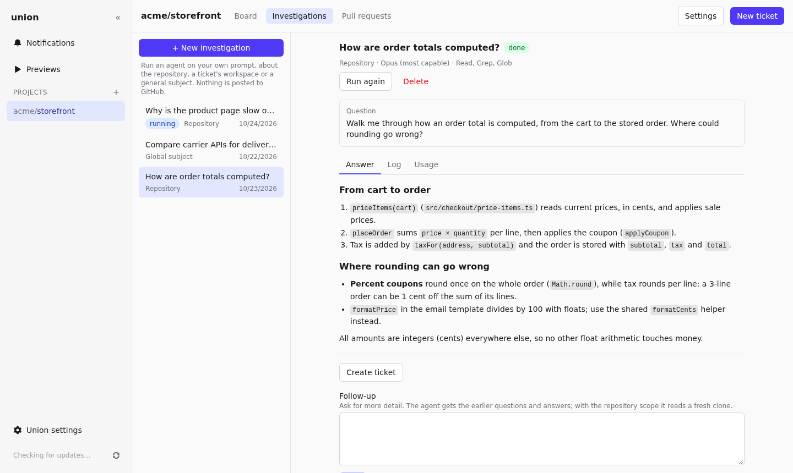

# Investigations

An investigation asks an agent one question, outside the ticket pipeline: how a part of the code works, where a bug
could come from, how two libraries compare. It creates no ticket and posts nothing to GitHub; the answer stays in
Union.

## Ask a question

Open the project bar's **Investigations** tab and click **+ New investigation**:

1. **Title** and **Prompt**: your question, sent to the agent as you write it.
2. **Scope**: where the agent works.

   | Scope              | The agent reads                                                                               |
   | ------------------ | --------------------------------------------------------------------------------------------- |
   | **Repository**     | A fresh clone of the project's repository, at its base branch.                                |
   | **A ticket**       | The ticket's own workspace, as its agent left it: its branch and uncommitted work. Read only. |
   | **Global subject** | No code at all: for general questions.                                                        |

3. **Model** and **tools**: Opus for hard questions, Haiku or Sonnet for quick ones. Add web search or a
   [connector](agents.md#tools-and-connectors) when the agent needs them.

The investigation waits for a free run slot, then runs once in a throwaway container (or, for **A ticket**, in
that ticket's container). Its tabs show the
**Answer**, the agent's **Log** as it works, and the **Usage** of its run. **Cancel** stops it.

**Investigate** in a ticket's panel opens the form with that ticket's workspace as the scope.

## Follow up

Once answered, type a **follow-up** question under the answer and click **Ask**. The agent gets your earlier
questions and its answers, and works in a fresh container, with a fresh clone for a repository investigation.

**Run again** asks the latest question again, for example after the code changed.

## Turn it into a ticket

**Create ticket** asks an agent to write a ticket from the whole investigation: a title, the problem, what to
change, acceptance criteria and the useful findings, in the language of your questions. Add context to say what the
ticket must cover.

The ticket lands in Backlog, with its GitHub issue, and the investigation links to it. When the project is
connected to Notion, **Also create it in Notion** adds a page for it in the Notion data source too.
