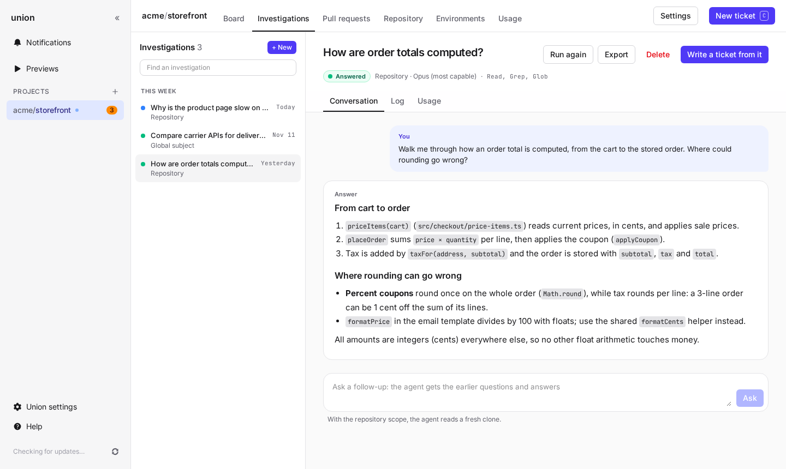

# Investigations

An investigation asks an agent one question, outside the ticket pipeline: how a part of the code works, where a bug
could come from, how two libraries compare. It creates no ticket and posts nothing to GitHub; the answer stays in
Union.

## Ask a question

Open the project bar's **Investigations** tab and click **+ New investigation**:

1. **Title** and **Prompt**: your question, sent to the agent as you write it.
2. **Scope**: where the agent works.

   | Scope              | The agent reads                                                                                                 |
   | ------------------ | --------------------------------------------------------------------------------------------------------------- |
   | **Repository**     | A fresh clone of the project's repository, at its base branch.                                                  |
   | **A ticket**       | The ticket's own workspace, as its agent left it: its branch, uncommitted work and running services. Read only. |
   | **Global subject** | No code at all: for general questions.                                                                          |

3. **Model** and **tools**: Opus for hard questions, Haiku or Sonnet for quick ones. Add web search or a
   [connector](agents.md#tools-and-connectors) when the agent needs them.

The investigation waits for a free run slot, then runs once in a throwaway container (or, for **A ticket**, in
that ticket's container). Its tabs show the
**Answer**, the agent's **Log** as it works, and the **Usage** of its run. **Cancel** stops it. An answer can hold
diagrams, drawn in place, with **SVG**, **PNG** and **Copy source** above each (see
[Diagrams](ticket-lifecycle.md#diagrams)). **Delete** removes the investigation and its answers, once you
confirm; it is not offered while the agent runs.

An investigation on **A ticket** shares that ticket's workspace with its steps: if the ticket starts a step first,
the investigation fails, and you ask again once the step is done. If the workspace changed during the run, the
answer ends with a warning: check it before the ticket's next step.

**Investigate** in a ticket's panel opens the form with that ticket's workspace as the scope.

## Follow up

Once answered, type a **follow-up** question under the answer and click **Ask**. The agent gets your earlier
questions and its answers, and works in a fresh container, with a fresh clone for a repository investigation.

**Run again** asks the latest question again, for example after the code changed.

## Export it

**Export** downloads the investigation as a Markdown file: its scope, model and tools, then every question with
its answer, oldest first. A question still running or failed says so in place of its answer. Nothing is sent
anywhere: the file is made in your browser.

## Turn it into a ticket

**Create ticket** asks an agent to write a ticket from the whole investigation: a title, the problem, what to
change, acceptance criteria and the useful findings, in the language of your questions. Add context to say what the
ticket must cover. It runs on the investigation's model. Once a ticket is made, the button reads **Create another
ticket**.

The ticket lands in Backlog, with its GitHub issue, and the investigation links to it. When the project is
connected to Notion, **Also create it in Notion** adds a page for it in the Notion data source too. When it is
connected to Jira, **Also create it in Jira** creates an issue for it in the Jira project, of the type picked in
the Jira settings (Task by default), with the ticket's title as its summary and its description as Jira's rich text
(headings, lists, checklists, tables and code keep their shape; inline code cannot be bold in Jira, so bold around it
is dropped). The ticket is then linked to the issue: its Jira tab and your Jira rules apply to it. One of the two at
most: a ticket comes from one tracker. If Jira refuses the issue (a field the project requires, a missing
permission), the ticket is still created and the investigation says why it has no issue.
