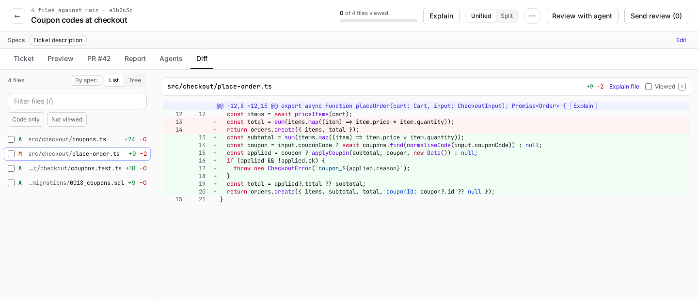

# Reviewing changes

Union has a full-page review for two kinds of change: a ticket's branch, and any pull request of the repository,
including ones written by people.

## Review a ticket's branch

Click **Review changes** in a ticket's panel. The page opens on the **Diff** tab:

- On the left, the changed files, as a **List** or a **Tree**. **By spec** groups them by the part of the spec they
  implement (see [Specs](#specs)). Press **j** and **k** to open the next or previous file, in the order the list
  shows them.
- Type a few letters of a path in **Filter files** (press **/** to get there) to list only the files whose path, or
  old path for a renamed file, has those letters in order. **Esc** clears it. **Code only** hides what Union does not
  count as code: tests, docs, lock files, migrations and binary files, or the patterns you set in
  **Settings → Agents → Change size**. Union remembers Code only in this browser. A file you already opened stays
  open even when the filter hides it, and the count above the list says how many files are shown, of how many.
- Tick a file's box in the list, or **Viewed** at the top of the open file, once you have read it; **v** marks the
  open file viewed and opens the next one. The header counts them ("12 of 300 files viewed"), and **Not viewed**,
  beside Code only, lists only the files left to read. The marks are kept in this browser, for this review; a file
  whose lines added or removed change after you marked it counts as not viewed again.
- On the right, one file at a time, with syntax highlighting, **Unified** or **Split** (side by side). Union
  remembers your choice in this browser.
- The commit picker shows all the changes, the changes since your last review, or one commit at a time.
- Lock files are listed apart, folded, at the end of the file list. Fold other paths the same way in the project's
  **Settings → Pull requests → Diff display**.

The other tabs show the ticket, its preview, its pull request, its [spec report](#spec-report) and your
[review agents](#your-review-agents), so you can check
the change against the request without leaving the page. The browser's Back and Forward buttons move between the
tabs you opened, and reloading the page keeps the tab you are on.

On a ticket [split into a stack](branches.md#split-into-a-stack), a row of tabs under the header picks what the
page shows: **All**, or one slice with its pull request and its number of drafts. A comment goes on the diff of the
slice you are on, and **Send review** gives the implementer a section per slice. The PR tab follows the slice you
pick.

The diff is a snapshot Union takes after each implementation run, so it shows what the agent left, even before the
branch is pushed.

### Comment and send

1. Click a line number to comment on that line. Shift-click another line number to extend it to a block.
2. Your comments stay drafts in Union until you send them.
3. **Send review** sends them all to the implementer, as a revision. While it cannot be sent (the ticket is not
   waiting on you, the pull request is merged), hover the button to read why.

You can send a review while the ticket waits for you at the implementation or the final review, or once it is Done
(its pull request open and not merged). Sent at the implementation, the revised code waits for you there again. Sent
at the final review or from Done, the final review runs again once the implementer is done; from Done, the ticket
goes back to In progress.

To bring in what people wrote on GitHub, click **Import from #\<PR\>** in the header's **⋯** menu (or **Import** in
the PR tab).
On a split ticket, the header's **⋯** menu has **Import from the stack**, which imports the comments of every open slice's pull request,
each onto its own slice.
Unresolved line comments become drafts on their lines, with the replies folded in. Review summaries and
conversation comments are offered one by one with **Add to review**, since bots post many of them. Comments whose
lines no longer exist show as outdated, with GitHub's excerpt. Once the implementer has worked on imported
comments, it drafts a reply to each for you to send (see [Reply to comments](branches.md#reply-to-comments)).

A comment on the ticket's Notion page can go to the implementer too: in the ticket's **Notion** tab, click **Add to
review** on the discussion (once the ticket has been implemented). The whole discussion becomes a comment of the
review, marked **on Notion**, which you can edit or delete before **Send review**; the implementer gets it under its
own heading, as a remark on the spec rather than the code. Nothing is posted or resolved in Notion: answer there
once the fix is in.

## Explain

Select lines and click **Explain**, click **Explain** on a hunk, or **Explain file** next to a file's name. An agent
answers in the **Explain** panel on the right:

- **How it works**, with links to the code it cites;
- **Specs**: quotes from the specs this code implements;
- **Docs**: the repository's own documents that relate to it;
- or **Not in the spec**, when nothing asked for it.

Ask a follow-up, or click **Copy as comment** to quote the answer in a draft comment on those lines. Explanations
asked on an older commit show as **Outdated**, with **Explain again**.

Each explanation is an agent run (Haiku by default) on your Claude usage. On a ticket, it is refused while the
ticket runs a step.

## Review with agent

**Review with agent** asks an agent (Opus by default) to read the change against its specs and leave line comments.
They arrive as drafts, like yours: keep, edit or delete each one before you send the review. The agent may also
leave a remark on the whole change, and findings about code outside the diff, shown above the files. Once it has
run, the button reads **Review again with agent**. On a split ticket, it reviews slice by slice.

Next to the button, Union says how much of the change the agent actually opened: "opened every file", or "did not
open 12 of 77 files (2092 of 4628 lines)". Hover it to see which files. A file it never opened got no review, so
check those yourself or run the review again. Files the review hides (lock files and your project's ignored
patterns) are not counted.

## Spec report

The **Report** tab tells you, before you read the diff, what needs your attention and what you can skim, judged
against the change's specs. Click **Write the report**: an agent reads the specs listed there (the [Specs](#specs)
bar's; with no spec, the button stays off) and the whole change, and writes:

- **How it works**: a small map of the change's main path (click a part to open it in the diff; the grey ones are
  not changed; the red numbers are the **Needs you** items about that part), and a walkthrough in a few steps:
  what happens, and why. Each why says where it comes from: **From the spec**, **From a commit** or **From a
  comment** (Union found those words there), or **Inferred** (the agent's reading, nothing checked it).
- **Needs you**: the few things to look at, most important first: a requirement done differently or missing,
  something nobody asked for (even inside a requirement that is done), a real risk, a question to settle before
  approving. Each has its lines and **Add as
  draft comment**. When nothing needs you, the report says so.
- **Read first**: the few files to start with, in order, each with why it matters and its key lines. While the
  report is current, these files carry a **Key** mark in the file list (hover it for the reason).
- **Skim**: the files you can go through quickly (wiring, renames, tests that mirror the code); click to open the
  list. They carry a **Skim** mark in the file list.
- **Requirements to check**, in the specs' own order: each **Partial**, **Missing**, **Done differently** or
  **Unclear in the spec**, with the spec's words, the code and the tests, and a note. Text the spec quotes (a
  label, a message) must match exactly, or the requirement is done differently. The ones **Done as asked** are
  folded: click to open them.
- **Not in the spec**: what the change does that nobody asked for, with a risk.
- **Risks**, **Questions** to ask the author, and **Docs to update**; at the end, the changed files the agent said
  nothing about, if any.

Not every item will be worth your time on every project. **Not useful** on an item hides it, and proposes a rule
for the next reports of this project ("Do not raise …"): edit it to cover the kind of item, or clear it to only hide
this one, then click **Hide it and keep the rule**, or **Hide it** with the rule cleared. The rule is kept on the
Memory page under **Spec report**, where you can edit or remove it.

In the Diff tab, while the report is current, the open file starts with what the report says about it (**Read
first**, **Skim**, and the **Needs you** items about it), and the lines an item points at carry a red bar with the
item's number.

Click a file or its lines to open them in the Diff tab. **Add as draft comment** opens the comment editor on those
lines with the note: nothing is sent until you send your review. **Add the gaps to the review** adds one draft on
the whole change listing the requirements missing, partial or done differently, with their notes: edit it, then send
it with your review (to the implementer on a ticket, on GitHub for a pull request). **Copy as markdown** copies the
whole report.

Union checks what the agent cites: a quote not found in the specs, or a file that does not exist, is left out, and
the report says how many it dropped. A spec that repeats another (a ticket imported from a Notion page, and that
page) is sent once, and images in a spec are left out. When the change moves on (a new snapshot, a new commit on the
pull request), the report shows as **Outdated**, with **Run again**.

A report is one agent run (Opus by default) on your Claude usage. On a ticket, it is refused while the ticket runs a
step. While it runs, the tab shows **Cancel**.

## Your review agents

The **Agents** tab runs the review agents you created (Union settings → **New agent** → **Review agent**, see
[Custom agents](agents.md#review-agents)). Without one yet, the tab offers **New review agent**.

1. Pick an agent and click **Run agent**. It reads the Specs bar's specs (it also runs with none), the change and
   its commits.
2. Union prepares a copy of the change for it, runs the project's install command there, then the agent reviews.
   It may build and test that copy; your ticket's workspace is left as it is.
3. Its answer shows in the tab, under the agent's name. A file it names, like `src/app.ts:12-30`, is a link: click
   it to open those lines in the Diff tab. A file the change does not touch stays plain text.

One agent runs at a time on a change; **Cancel** stops it. Each agent keeps its last answer here: **Run again**
replaces it, and **Copy as markdown** copies it. When the change moves on, the answer says so.

A run uses your Claude usage, with the agent's own model (Sonnet by default). On a ticket, it is refused while the
ticket runs a step. On a pull request from a fork, nothing is installed and the agent only reads the code.

## Specs

The **Specs** bar under the header lists what the change is supposed to do. Explain, Review with agent, Group by
spec and the spec report all read it.

- It starts with the ticket's description and the Notion page or Jira issue it came from, or the pull request's
  description.
- **Edit** opens the list: edit a spec's text for this review (it is marked "edited"), go back to its source with
  **Use the source**, remove it, or **Add a spec** from the pull request's description, the ticket, a GitHub issue,
  a Notion page or, when the project is connected to Jira, a Jira issue (its key or link: any issue of your Jira
  site the account can see, not only the project's). A Jira issue's spec is its description, without its comments.
- Sources are read again each time, so a page edited in Notion or an issue edited in Jira is read as it is now.

## Review other people's pull requests

The project bar's **Pull requests** tab lists the repository's pull requests: **Open**, **Closed** or **All**,
newest first, as a table: their state, title and branches (and review state), author, when they were last updated,
and their size, with a small bar of lines added and removed. Stacks of pull requests show as one row.

**Find by title, #number or branch** narrows the list as you type. **With a ticket** keeps only the pull requests
Union opened for a ticket, and **Drafts hidden** leaves out the drafts; the count beside them says how many are
left ("5 of 15 open").

- A pull request opened by Union for a ticket has **Open ticket**.
- Any other has **Add to reviews**, which puts it under **Under review** at the top of the tab, for this project:
  one card per pull request (or stack), with **Open review**.
  **Add stack to reviews** adds every pull request of a stack.

**Open review** opens the same review page, with these tabs:

| Tab             | What it shows                                                                                                                                                                                    |
| --------------- | ------------------------------------------------------------------------------------------------------------------------------------------------------------------------------------------------ |
| **Description** | The pull request's description, and the Notion pages and Jira issues it implements (**Link** them here).                                                                                         |
| **Notion**      | Each linked Notion page's **Properties** (edit them as in a ticket's Notion tab), its text, then its open comments (read only).                                                                  |
| **Jira**        | Each linked Jira issue's **Properties** (edit them, or move its status, as in a ticket's Jira tab), its description, its comments.                                                               |
| **Comments**    | Its line threads (the resolved ones folded below the open ones), then its review summaries and conversation, each with **Reply** or **Quote reply**; a thread's file and lines open in the diff. |
| **Report**      | The [spec report](#spec-report), as for a ticket.                                                                                                                                                |
| **Agents**      | [Your review agents](#your-review-agents), as for a ticket.                                                                                                                                      |
| **Preview**     | A [preview](previews.md#previews-of-pull-requests-under-review) of the pull request's code.                                                                                                      |
| **Diff**        | The diff, comments, Explain and Review with agent, as for a ticket.                                                                                                                              |

The **Description** tab has a section for each tracker the project is connected to: **Notion pages**, **Jira
issues**. The pages and issues the pull request names, in its title, its branch (`feature/ABC-123-dark-mode`) or its
description (a Notion link, a Jira key or link to the issue), are offered with **Link**. With nothing linked yet, the
field to paste a link or a key shows at once; else click **Link another page** (or issue). **Check** shows the
item's title first; a Jira issue can be any issue of your Jira site the account can see. A linked item has
**Unlink**, and, for a pull request in a stack, **Link the whole stack to this page** (or issue) gives it to the
stack's pull requests that have none. Linked items are specs of the review, and the rules on "You post a review" act
on them (see [Automation](automation.md)). Nothing is written to Notion or Jira when you link or unlink.

**Send review** posts one review on GitHub, signed by your token or the GitHub App: **Comment**, **Approve** or
**Request changes**. Your overall note becomes its body, and each draft a line comment. Drafts on lines that are no
longer in the diff, or that reach past the changed lines, are quoted in the body instead, so the rest still goes. If GitHub refuses (for example, an approval of your own pull
request), your drafts stay, with GitHub's reason.

A pull request that is part of a stack opens with a tab per pull request of the stack, bottom first, each with its
number of drafts. There, **Review with agent** asks whether to review **The whole stack** or **This pull request
only**.

The browser's Back and Forward buttons move between the pull requests and tabs you opened, Back again closes the
review page, and reloading the page keeps the pull request and tab you are on.

**Stop reviewing #\<PR\>** (the bin on its card) removes a pull request from Under review, after you confirm: its drafts are
deleted and its preview stopped.
A pull request that is merged or closed on GitHub leaves Under review on its own, the same way, the next time the
list is read.

The list is read from GitHub when the tab opens, at most once a minute; click **Refresh** to read it again.
