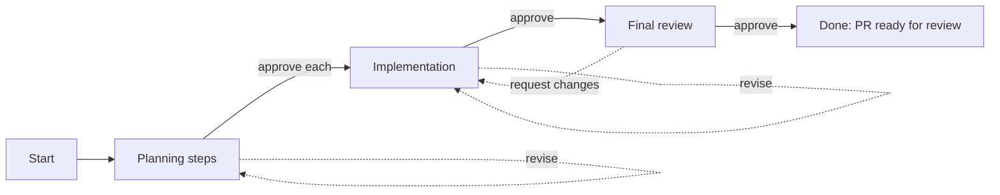
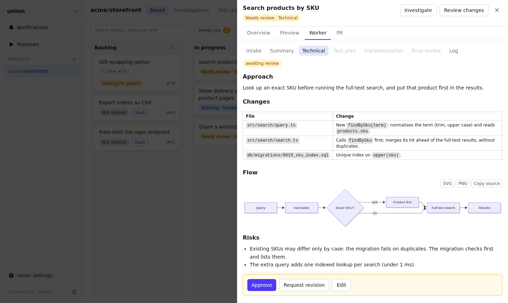

# From ticket to pull request

Once a ticket starts, it goes through the steps of its [flow](tickets.md#flows), one at a time. After each step it
stops and waits for you: nothing moves forward until you approve it.

Each step's output is a tab in the ticket's **Worker** tab, and a comment on the GitHub issue. When you ask for a
revision, Union edits that comment instead of adding another one.

## Planning

| Step          | Default model | What it writes                                                                      |
| ------------- | ------------- | ----------------------------------------------------------------------------------- |
| **Intake**    | Haiku         | The questions the request leaves open, each followed by an `Answer:` line for you.  |
| **Summary**   | Sonnet        | What the ticket asks for, in a few lines, with what is in and out of scope.         |
| **Technical** | Opus          | The technical plan: the approach, the files to change, the risks. Diagrams welcome. |
| **Test plan** | Sonnet        | The tests that prove the change works.                                              |

The agents read the repository but do not change it during planning. Each step reads the steps approved before it.

Under each output:

- **Approve** runs the next step.
- **Request revision** asks for changes: write what is wrong, and the same agent revises its output, in the same
  session, so it remembers what it wrote.
- **Edit** changes the output yourself, for example to fix a detail without spending a run. **Save new version**,
  then approve.

### Answer the intake questions

When the Intake step asks questions, the tab shows a text box under each one. Type your answers, then **Approve**:
Union writes them into the output, and the next steps read the questions with your answers.

## Implementation

After the last planning step is approved, the implementation agent (Opus by default) writes the code on the
ticket's branch:

1. It runs the project's **install command**, then works on the change.
2. It runs the **check command**. If the checks fail, it gets their output and fixes the code, up to the
   project's iteration limit.
3. It commits its work. Union pushes the branch and opens a **draft pull request** that closes the issue. The pull
   request's description follows the repository's pull request template when it has one.

The tab then shows the agent's report: what changed and how the checks ended. Read it, look at the diff with
**Review changes**, then **Approve** to run the final review, or **Request revision** with what to change.

The agent works in the ticket's own container and workspace, which stay between steps: a revision continues from
where it was.

## Final review

A separate agent (Opus by default) reads the branch and compares it with the approved plan. Its review starts with
a verdict:

- **APPROVED**: nothing blocks the change. Remarks that do not block are listed under "Optional".
- **CHANGES REQUESTED**: bugs, missed acceptance criteria, missing planned tests, or risky changes.

The reviewer does not run the checks again; it reports how they ended in the implementation. You decide what
happens next, whatever the verdict:

- **Approve and mark PR ready** marks the pull request ready for review and moves the ticket to **Done**.
- **Request changes** sends your notes back to the implementer. **Send findings to the implementer** fills the
  request with the review's findings, which you can edit. The implementer works on them, then a new final review
  runs. A new review knows the earlier one, and says which findings are fixed and which are still open.
- **Review changes** opens the diff, where you can comment on lines and send those comments to the implementer.
  See [Reviewing changes](reviewing.md).

Union never loops on its own: it stops after each review and waits for you.

## Done

A Done ticket keeps its container, workspace and branch, so you can still:

- run its [preview](previews.md);
- send more comments from **Review changes**, which takes it back to In progress, then the final review;
- [rebase it, change its target, simplify its history or split it](branches.md) while its pull request is open.

Merge the pull request on GitHub as usual. Once it is merged or closed, the ticket moves to **Merged / Closed**.

## When a step stops

| What you see                                  | What it means                                                         | What to do                                                             |
| --------------------------------------------- | --------------------------------------------------------------------- | ---------------------------------------------------------------------- |
| **Run failed:** and an error                  | The run ended with an error (a crash, a timeout, a Docker problem).   | Read the **Log**, fix the cause if it is on your side, then **Retry**. |
| **Claude usage limit reached**                | Your Claude subscription hit its usage limit.                         | Wait until it resets, then **Retry**.                                  |
| **A git hook refused to commit some changes** | A pre-commit hook of the repository refused the agent's last changes. | See below.                                                             |

When a hook refuses a commit, the panel shows the changes and what the hook said. You can:

- **Commit without hooks and continue**, with the commit message you choose;
- **Leave these changes out and continue**, which drops what was not committed;
- **Send back to the agent** (during the implementation), with guidance on how to fix what the hook refused.

## Watch an agent work

The **Log** tab in the Worker tab shows what the agent does as it does it: the files it reads, the commands it runs,
its messages. The Overview lists every run with its model, duration and tokens used.

The token usage shows what the same tokens would cost on the Anthropic API. A Claude Max subscription does not bill
it; it helps compare models and steps.
