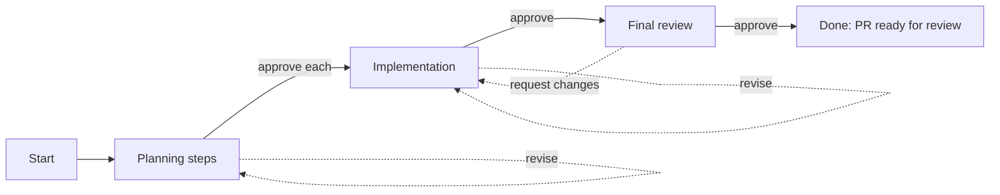
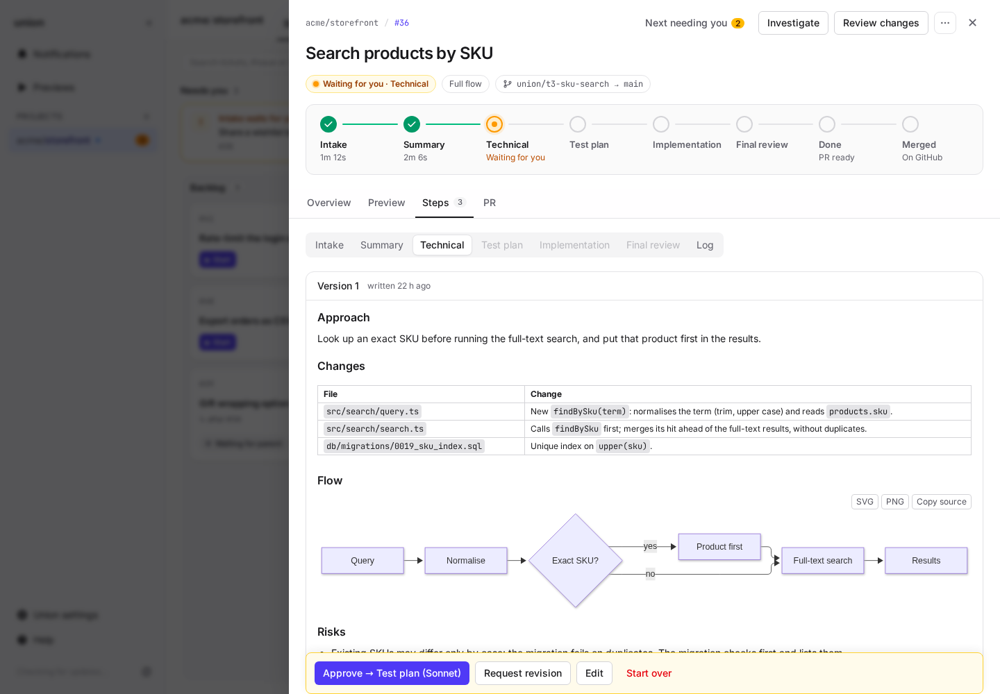

# From ticket to pull request

Once a ticket starts, it goes through the steps of its [flow](tickets.md#flows), one at a time. After each step it
stops and waits for you: nothing moves forward until you approve it.

Each step's output is a tab in the ticket's **Worker** tab, and a comment on the GitHub issue. When you ask for a
revision, Union edits that comment instead of adding another one.

## Planning

| Step          | Default model | What it writes                                                                          |
| ------------- | ------------- | --------------------------------------------------------------------------------------- |
| **Intake**    | Haiku         | The questions the request leaves open, each followed by an `Answer:` line for you.      |
| **Summary**   | Sonnet        | What the ticket asks for, with numbered acceptance criteria, decisions and assumptions. |
| **Technical** | Opus          | The technical plan: the approach, the files to change, the risks, the estimated size.   |
| **Test plan** | Sonnet        | The tests that prove the change works.                                                  |

The agents read the repository but do not change it during planning. Each step reads the steps approved before it.

Under each output:

- **Approve** runs the next step.
- **Request revision** asks for changes: write what is wrong, and the same agent revises its output, in the same
  session, so it remembers what it wrote.
- **Edit** changes the output yourself, for example to fix a detail without spending a run. **Save new version**,
  then approve.
- **Start over** runs the step again from scratch, after you confirm: the agent starts a new session and sees
  neither the versions it wrote nor your feedback. Use it when a plan went the wrong way and revising it would keep
  too much of it. The earlier versions stay in the version list. **Start over** also shows when a planning step
  failed or hit the usage limit, beside **Retry**.

### Answer the intake questions

When the Intake step asks questions, the tab shows a text box under each one. Type your answers, then **Approve**:
Union writes them into the output, and the next steps read the questions with your answers.

## Implementation

After the last planning step is approved, the implementation agent (Opus by default) writes the code on the
ticket's branch:

1. It runs the project's **install command**, then works on the change.
2. It runs the **check command**. If the checks fail, it gets their output and fixes the code, up to the
   project's iteration limit.
3. It commits its work. Union pushes the branch and opens a **draft pull request** that closes the issue. The pull
   request's description follows the repository's pull request template when it has one.

The tab then shows the agent's report: what changed, how the checks ended, and where it departed from the plan. Read it, look at the diff with
**Review changes**, then **Approve** to run the final review, or **Request revision** with what to change.

The agent works in the ticket's own container and workspace, which stay between steps: a revision continues from
where it was.

### The size of a change

Agents tend to write more code than a task needs. Union counts the lines of code each implementation adds, leaving
out tests, lock files, migrations and docs, and shows it as **Size** in the ticket's Overview, for example "312 lines
of code (+840 tests), for ~150 estimated". Hover it to see the files.

The budget comes from the **Technical** step, which ends its plan with "Estimated size: 150 lines of code". To change
the budget, **Edit** that line before you approve the plan. A flow without the Technical step uses the project's
budget, if you set one (**Settings → Agents → Change size**); otherwise the size is only shown.

When a ticket's first implementation, with its checks green, adds more than one and a half times its budget, the
implementer gets one more turn to cut what the task does not need: options nobody asked for, code that is used once,
cases that cannot happen. It runs the checks again and explains why what is left is needed. Its report shows the
size before and after. If the checks fail after the cut, Union keeps the code as it was before.

Nothing waits on the size: the final review reads it, and treats code the task does not need as a reason to request
changes. Revisions are measured, never cut.

## Final review

A separate agent (Opus by default) reads the branch and compares it with the approved plan. Its review starts with
a verdict:

- **APPROVED**: nothing blocks the change. Remarks that do not block are listed under "Optional".
- **CHANGES REQUESTED**: bugs, missed acceptance criteria, missing planned tests, risky changes, or code the task
  does not need.

The reviewer does not run the checks again; it reports how they ended in the implementation. You decide what
happens next, whatever the verdict:

- **Approve and mark PR ready** marks the pull request ready for review and moves the ticket to **Done**.
- **Request changes** sends your notes back to the implementer. **Send findings to the implementer** fills the
  request with the review's findings, which you can edit. The implementer works on them, then a new final review
  runs. A new review knows the earlier one, and says which findings are fixed and which are still open.
- **Review changes** opens the diff, where you can comment on lines and send those comments to the implementer.
  See [Reviewing changes](reviewing.md).

Union never loops on its own: it stops after each review and waits for you.

## Done

A Done ticket keeps its container, workspace and branch, so you can still:

- run its [preview](previews.md);
- send more comments from **Review changes**, which takes it back to In progress, then the final review;
- [rebase it, change its target, simplify its history or split it](branches.md) while its pull request is open.

Merge the pull request on GitHub as usual. Once it is merged or closed, the ticket moves to **Merged / Closed**.

Once the pull request is merged, Union removes the ticket's preview, container and workspace within a minute or two,
along with the images its preview built, to free disk space and Docker networks. The ticket's Log says when. Its
branch, pull request and history in Union stay. A pull request closed without a merge keeps them, since it can be
reopened.

## When a step stops

| What you see                                  | What it means                                                         | What to do                                                                                          |
| --------------------------------------------- | --------------------------------------------------------------------- | --------------------------------------------------------------------------------------------------- |
| **Run failed:** and an error                  | The run ended with an error (a crash, a timeout, a Docker problem).   | Read the **Log**, fix the cause if it is on your side, then **Retry**.                              |
| **Claude usage limit reached**                | Your Claude subscription hit its usage limit.                         | Nothing: Union retries by itself after the reset, at the time shown. **Retry now** runs it at once. |
| **A git hook refused to commit some changes** | A pre-commit hook of the repository refused the agent's last changes. | See below.                                                                                          |

When a hook refuses a commit, the panel shows the changes and what the hook said. You can:

- **Commit without hooks and continue**, with the commit message you choose;
- **Leave these changes out and continue**, which drops what was not committed;
- **Send back to the agent** (during the implementation), with guidance on how to fix what the hook refused.

## Watch an agent work

The **Log** tab in the Worker tab shows what the agent does as it does it: the files it reads, the commands it runs,
its messages. The Overview lists every run with its model, duration and tokens used.

The token usage shows what the same tokens would cost on the Anthropic API. A Claude Max subscription does not bill
it; it helps compare models and steps.
